# Дизайн экранов

Публичная главная страница и четыре экрана приложения: вход, чат, SQL-задание, тарифы. Для каждого — раскладка на телефоне (ширина 360 px) и ноутбуке (1280 px), состояния и скриншоты из `docs/design/`. Отдельный раздел описывает анимацию.

Скриншоты сняты с работающего frontend в режиме тестовых данных (`VITE_MOCK_API=all`), поэтому совпадают с тем, что видит пользователь. Ноутбук — 1280×800, телефон — 360 px при плотности 2×.

## Стиль

### Принципы

- Спокойный интерфейс для учёбы: тёплый светлый фон, белые карточки, один акцентный цвет — индиго.
- Заголовки — крупным выразительным шрифтом, текст — нейтральным. Код и SQL — всегда моноширинным шрифтом на отдельном фоне.
- Ответы ИИ всегда помечены бейджем «Сгенерировано ИИ», источники — под ответом.
- Тёмная тема включается автоматически по настройке системы (`prefers-color-scheme`).

### Цвета

Токены заданы в `frontend/src/index.css` как CSS-переменные и подключены в Tailwind (`bg-surface`, `text-muted`, `bg-primary` и т. д.). В компонентах используются только эти имена, а не конкретные цвета.

| Токен | Светлая | Тёмная | Где |
|---|---|---|---|
| `bg` | `#f5f3ee` | `#0c0d12` | фон страницы |
| `surface` | `#ffffff` | `#15171e` | карточки, шапка, поля |
| `surface-muted` | `#eeebe4` | `#1f212b` | код, шапки таблиц, неактивное |
| `border` | `#dfdbd1` | `#2b2e3a` | рамки |
| `text` | `#15161b` | `#ecedf2` | основной текст |
| `muted` | `#5a5d66` | `#9b9eab` | подписи, второстепенный текст |
| `primary` | `#4338ca` | `#8f91ff` | кнопки, ссылки, сообщения студента |
| `primary-soft` | `#e9e8fc` | `#23244b` | выбранная тема, источники |
| `success` / `success-soft` | `#137343` / `#e3f4e9` | `#4cc283` / `#12301f` | «Верно» |
| `warning` / `warning-soft` | `#865600` / `#fdf1d6` | `#f0c25a` / `#33290f` | «Сгенерировано ИИ», лимит, неверный результат |
| `danger` / `danger-soft` | `#bf342a` / `#fcebe9` | `#f27a70` / `#3a1c1a` | ошибки, ошибка SQL |

Все пары текст/фон в обеих темах дают контраст не ниже 4.5:1 (WCAG AA); самая низкая пара — `danger` на `danger-soft`, 4.87:1.

Кроме цветов, есть токены теней: `shadow-card` (карточки) и `shadow-pop` (приподнятые элементы: главная кнопка, окно редактора, Premium).

### Шрифты

Оба шрифта загружаются из пакетов `@fontsource-variable` и входят в сборку, внешних запросов нет.

- Текст: Inter.
- Заголовки (`font-display`): Geologica. Проверено в браузере: оба шрифта содержат все казахские буквы (Әә Ғғ Ққ Ңң Өө Ұұ Үү Һһ Іі). Unbounded, Manrope, Jost, Dela Gothic One и Russo One отклонены — в них этих букв нет.
- Код: системный моноширинный (`Cascadia Code`, `Consolas` и т. д.), ничего не загружается.
- Размеры: заголовок страницы 30 px жирный, заголовок карточки 18 px, текст 16 px, подписи 14 px, бейджи 12 px. На главной заголовки секций 30–48 px, первый экран — до 72 px.

### Элементы

Все в `frontend/src/components/ui.tsx`.

| Элемент | Вид |
|---|---|
| Кнопка primary | фон `primary`, «таблетка», высота от 44 px, тень `shadow-card`. Одна главная кнопка на экране |
| Кнопка secondary | фон `surface` с рамкой — быстрые действия, второстепенное |
| Кнопка ghost | без фона — «Выйти», «Другое задание» |
| `ButtonLink`, `ButtonAnchor` | ссылка на страницу или якорь в виде кнопки — «Войти», «Начать», «Как это работает» |
| Кнопка disabled / loading | прозрачность 50 %; при загрузке — спиннер слева от текста |
| Поле ввода | рамка `border`, скругление 12 px, высота от 44 px, шрифт 16 px (на iPhone не зумит страницу). Фокус — рамка и широкая подсветка `primary`. Ошибка — красная рамка и текст под полем |
| Карточка | фон `surface`, рамка, скругление 20 px, тень `shadow-card`, отступ 20–24 px |
| Сообщение | `Alert`: ошибка, информация, успех, предупреждение — мягкий фон, тонкая рамка и текст того же тона |
| Бейдж | маленькая «таблетка»: план, «Тестовые данные», «Сгенерировано ИИ», «Скоро» |

Отступы — шаг 4 px (Tailwind). Ширина контента — до 1152 px по центру, поля по бокам 16 px.

### Адаптивность

- До 640 px: одна колонка, навигация — второй строкой шапки, бейджи плана и «Тестовые данные» скрыты.
- До 768 px: сцены главной страницы упрощены (см. «Анимация»).
- От 1024 px: у входа появляется левая панель, у чата — боковая колонка тем, у задания — две колонки.
- Горизонтальной прокрутки страницы нет на 360 px; широкие блоки кода, таблицы и ряд быстрых действий в чате прокручиваются внутри себя.

## Общая шапка

```
Ноутбук:
┌──────────────────────────────────────────────────────────────────────────┐
│ [U] Ustaz  (Тестовые данные)  Чат  Тарифы        [KK|RU|EN] Aliya (Free) Выйти │
└──────────────────────────────────────────────────────────────────────────┘
Телефон:
┌──────────────────────────────┐
│ [U] Ustaz   [KK|RU|EN] Выйти │
│ Чат  Тарифы                  │
└──────────────────────────────┘
```

Переключатель языка есть на всех страницах, включая вход и главную. Если пользователь вошёл, выбранный язык сохраняется в профиль (`PATCH /api/users/me`).

## Главная страница

Адрес `/`, открыта всем. Загружается отдельным чанком, поэтому не утяжеляет чат. В шапке гостю — «Войти», вошедшему — «Открыть чат».

```
┌ [U] Ustaz                          [KK|RU|EN] [Войти] ┐
│ 01 / Учебный ассистент по SQL                          │
│ Учи SQL вместе с тремя ИИ-агентами      (сетка точек)  │
│ [Начать] [Как это работает]                            │
├ 02 / Три агента ──────────────────────────────────────┤
│ подпись шага           вопрос → оркестратор → 3 агента │
├ 03 / SQL-песочница ───────────────────────────────────┤
│ задание               окно запроса, таблица, «Верно»   │
├ 04 / Пять тем курса ── карточки тем едут влево ───────┤
├ 05 / Прогресс по темам (Скоро) ── шкалы освоения ─────┤
├ 06 / Тарифы ── Free, Premium, призыв [Начать] ────────┤
└ Подвал: Ustaz, команда, ссылка на GitHub ─────────────┘
```

- Тексты — через переводы (`landing.*` в kk, ru, en). Запрос и строки результата в песочнице — из учебной базы `frontend/src/mocks/course.ts`.
- «Прогресс по темам» — пример с бейджем «Скоро»: модель знаний появится позже.
- Тарифы берутся из `GET /api/billing/plans`. Эндпоинт пока требует входа, поэтому гостю на реальном backend карточки показываются без цены и лимита.
- «Начать» ведёт на `/register`, вошедшему — «Открыть чат» → `/chat`.

| Первый экран | Сцена «Три агента» | Телефон |
|---|---|---|
| 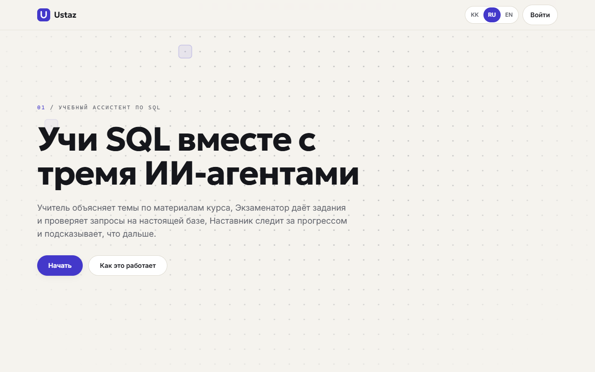 | 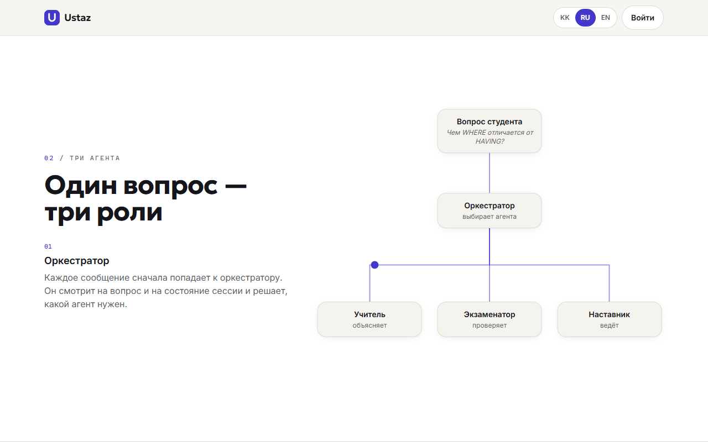 | 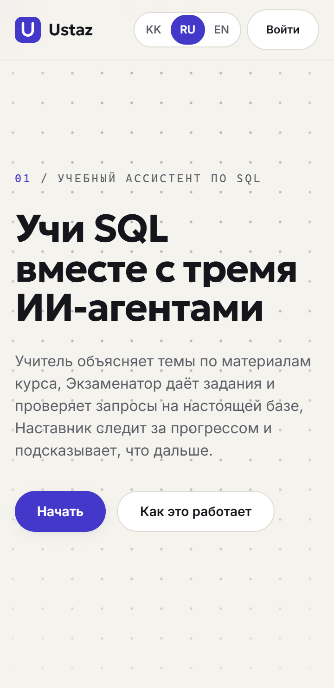 |

## 1. Вход и регистрация

```
Ноутбук:
┌ Ustaz ──────────────────────────────────────────── [KK|RU|EN] ┐
│ ┌ Учебный ассистент по SQL ─┐   ┌ Вход ────────────────────┐ │
│ │ Учи SQL вместе с тремя    │   │ [ ошибка сервера ]       │ │
│ │ ИИ-агентами               │   │ E-mail   [____________]  │ │
│ │ (Учитель) (Экзаменатор)   │   │ Пароль   [____________]  │ │
│ │ (Наставник)               │   │ [        Войти         ] │ │
│ └───────────────────────────┘   └──────────────────────────┘ │
Телефон: только форма во всю ширину.
```

- На ширине от 1024 px слева панель: что такое Ustaz и три агента. На телефоне — только форма.
- Регистрация: имя, e-mail, пароль, повтор пароля, язык обучения.
- Ошибки полей — под полем сразу при отправке (пустое поле, неверный e-mail, пароль короче 8 символов или длиннее 72 байт). Ошибки сервера (`invalid_credentials`, `email_taken`, нет связи) — красным блоком над полями.
- Загрузка — спиннер в кнопке, кнопка неактивна.

| Ноутбук | Телефон | Тёмная тема |
|---|---|---|
| 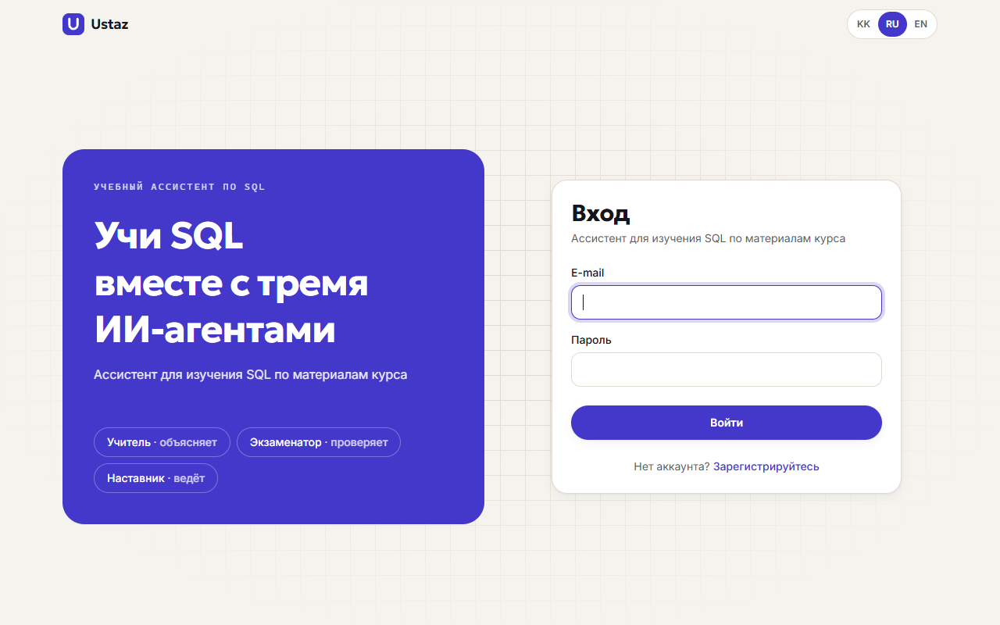 | 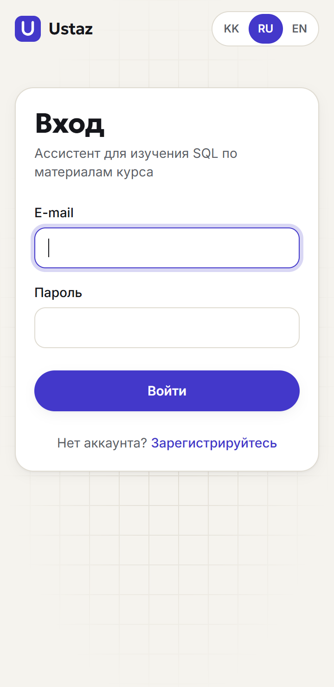 | 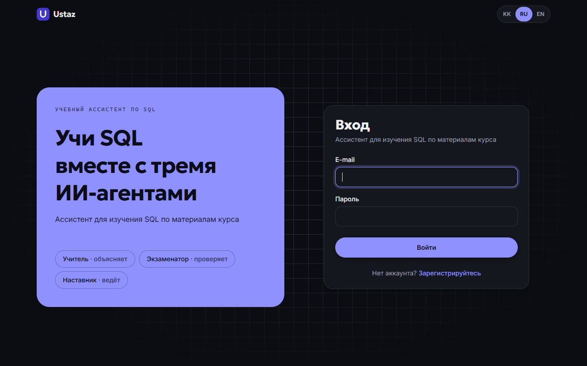 |

## 2. Чат

```
Ноутбук:
┌ Темы курса ───┐ ┌──────────────────────────────────────────────┐
│ (1) SELECT…   │ │                   [Объясни тему «…»]  (студент) │
│ (2) Сортировка│ │ (У) ┌ Учитель (Сгенерировано ИИ) ──────┐      │
│ (3) Агрегаты  │ │     │ текст, ```код```                  │      │
│ (4) JOIN      │ │     │ Источники: [Конспект: …]          │      │
│ (5) Подзапросы│ │     └───────────────────────────────────┘      │
└───────────────┘ │ ── лента прокручивается внутри ─────────────── │
                  │ (Объясни тему) (Подсказка) (Не понял) (Задание) │
                  │ ┌ Сообщение…                     [Отправить] ┐ │
                  └──────────────────────────────────────────────────┘
Телефон: вместо колонки тем — выпадающий список «Тема» над чатом,
быстрые действия — одна строка, листается вбок.
```

- Чат занимает высоту экрана под шапкой: лента сообщений прокручивается внутри себя, поле ввода всегда на виду.
- Сообщения студента — справа, в цвете `primary`. Ответы ассистента — слева, белая карточка с кружком-буквой агента: имя агента, бейдж «Сгенерировано ИИ», текст с блоками кода, список источников.
- Быстрые действия работают, когда выбрана тема: «Объясни тему» (`action: explain`), «Подсказка» (`action: hint`), «Дай задание» (открывает экран задания). Без темы над ними подсказка «Выберите тему…».
- Enter — отправить, Shift+Enter — новая строка.
- Состояния: загрузка истории; пустой чат с подсказкой, что спросить; «Ассистент отвечает…» с тремя прыгающими точками; ошибка — красный блок над кнопками, текст сообщения возвращается в поле; лимит Free (429) — жёлтый блок со ссылкой «Перейти на Premium».
- Первый экран `/chat` — выбор курса и кнопка «Продолжить» для последней сессии.

| Ноутбук | Телефон | Тёмная тема |
|---|---|---|
| 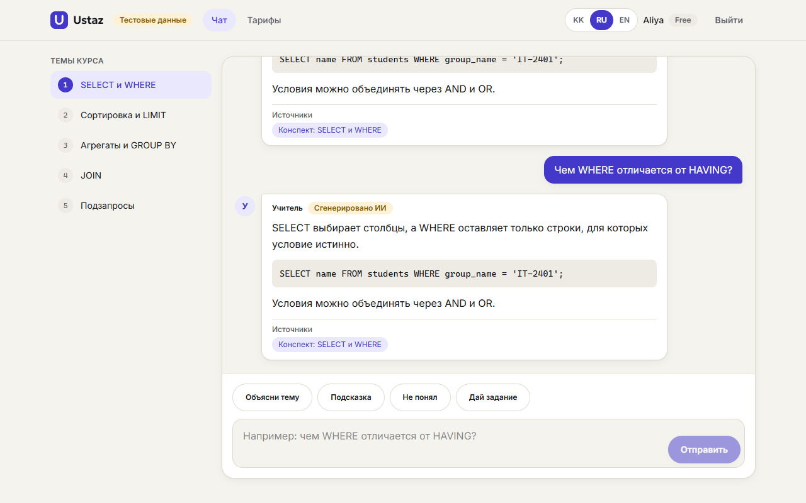 | 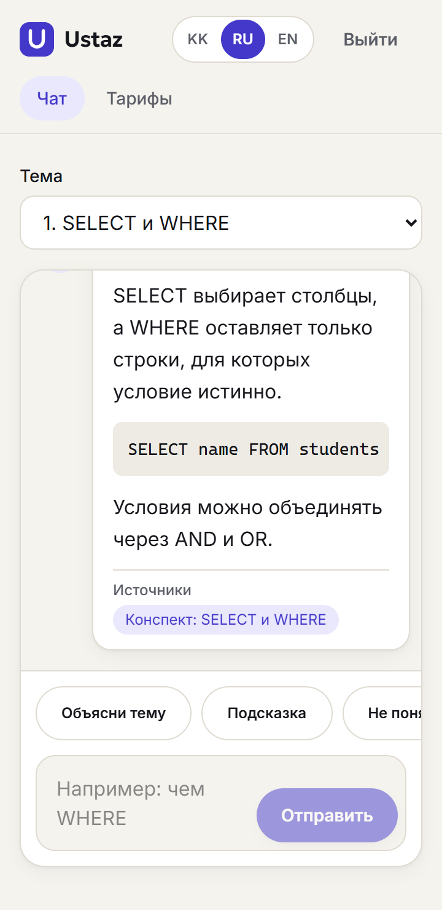 | 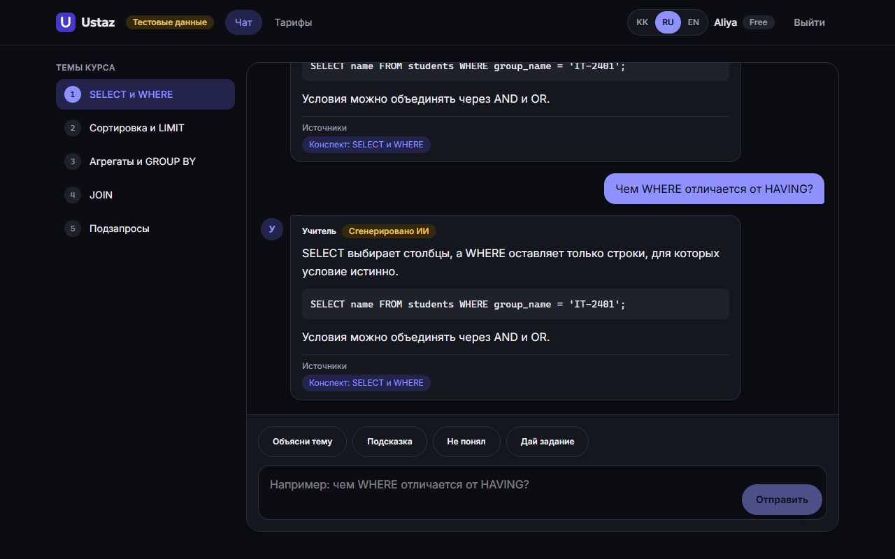 |

## 3. SQL-задание

```
Ноутбук:
← Вернуться в чат
┌ SQL-задание   Сложность: 1 ┐ ┌ ● ● ●  Ваш SQL-запрос ──────────┐
│ Условие задания            │ │ [ SELECT …                     ] │
│ Таблицы учебной базы       │ │ [Проверить]  Ctrl + Enter        │
│ ┌students─┐ ┌grades──┐     │ └──────────────────────────────────┘
│ │id  INT  │ │…       │     │ ┌ (✓ Верно! / Не совпадает / Ошибка)┐
│ └─────────┘ └────────┘     │ │ Результат запроса (строк: N)     │
└────────────────────────────┘ │ таблица                          │
                               │ [Следующее задание]              │
                               └──────────────────────────────────┘
Телефон: условие, затем запрос, затем результат — одной колонкой.
```

- Схема таблиц — карточки «имя столбца — тип».
- Поле запроса — окно в виде небольшого редактора, моноширинный шрифт, без автозамены и проверки орфографии.
- Результат по `feedback_code`: `correct` — зелёный с галочкой, `wrong_result` — жёлтый, `sql_error` — красный плюс текст ошибки SQLite.
- Таблица результата — до 50 строк, прокрутка внутри, `NULL` серым курсивом.
- После верного ответа — «Следующее задание». После неверного — «Спросить подсказку в чате» (возвращает в чат и сразу просит подсказку) и «Другое задание».
- Эталонный ответ нигде не показывается.

| Ноутбук | Телефон | Тёмная тема |
|---|---|---|
| 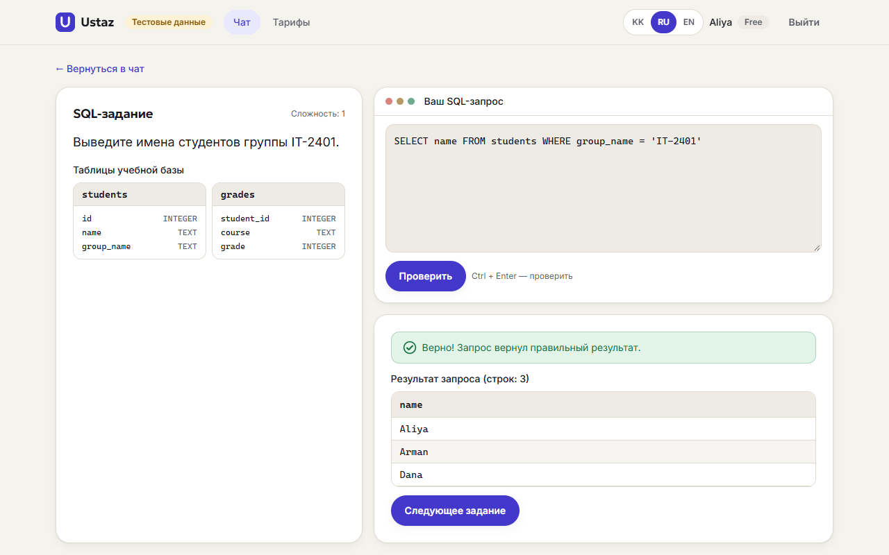 | 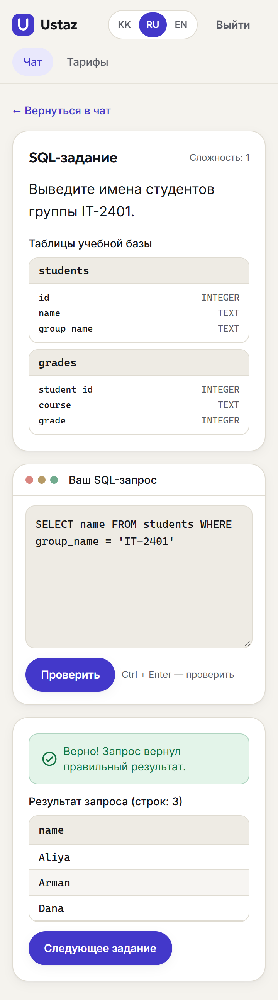 | 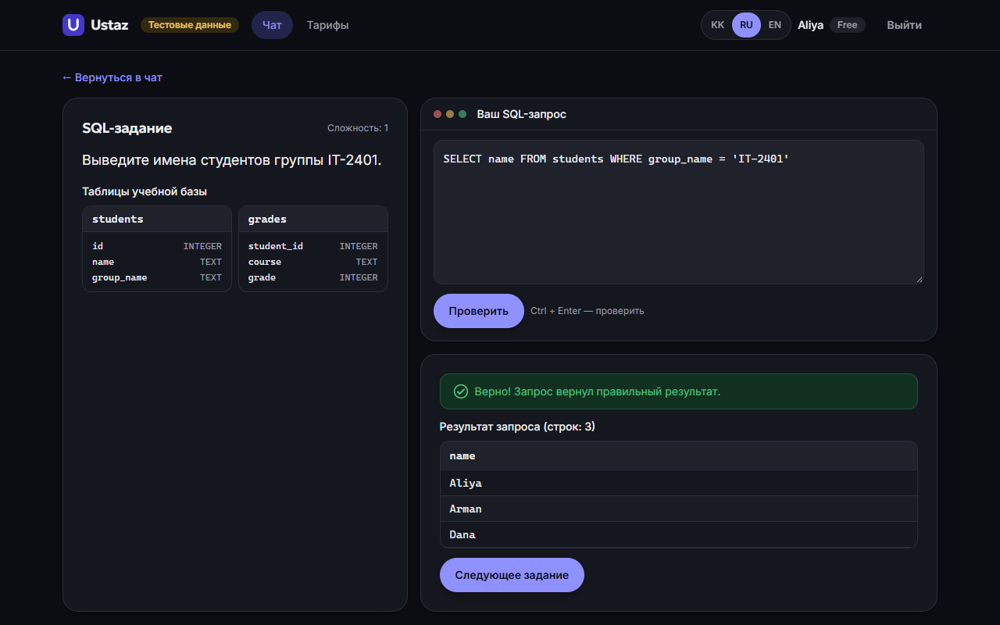 |

## 4. Тарифы

```
┌ Ваш тариф: (Free) ─────────────────────────────┐
│ Сообщений сегодня                        7 / 20 │
│ ███████░░░░░░░░░░░░░                            │
└─────────────────────────────────────────────────┘
┌ Free ──────────────────┐ ┌ Premium ───────────────┐
│ Бесплатно              │ │ 4,99 $ / месяц         │
│ До 20 сообщений в день │ │ Без лимита сообщений   │
│ ✓ …                    │ │ ✓ …                    │
│ [Ваш текущий тариф]    │ │ [ Перейти на Premium ] │
└────────────────────────┘ └────────────────────────┘
Телефон: карточки друг под другом.
```

- Текущий тариф выделен рамкой `primary`, Premium приподнят тенью `shadow-pop`. Прогресс-бар становится красным, когда лимит исчерпан.
- Цена форматируется под язык интерфейса (`4,99 $` / `$4.99`).
- «Перейти на Premium»: с Paddle открывается окно оплаты Paddle Checkout поверх страницы; с тестовым провайдером план меняется сразу.
- После оплаты: «Оплата прошла, обновляем тариф…», затем «Готово! Тариф Premium подключён». Если план не обновился за 30 секунд — информационное сообщение обновить страницу позже.
- Для Premium показывается дата окончания оплаченного периода.

| Ноутбук | Телефон | Тёмная тема |
|---|---|---|
| 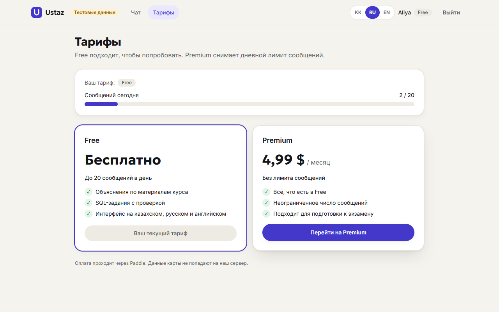 | 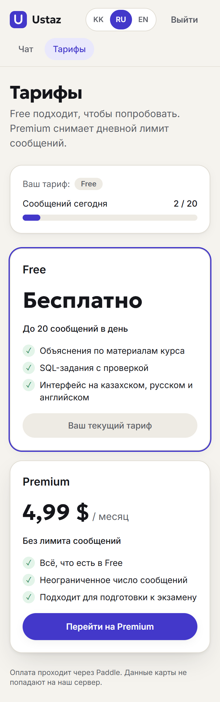 | 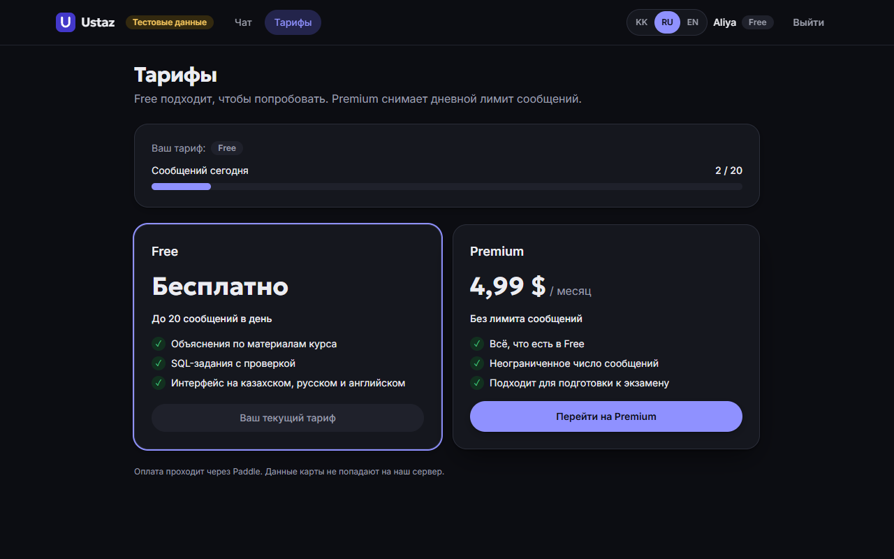 |

## Анимация

### На чём сделано

- **GSAP** — все анимации. В React только через хук `useGSAP`: он сам удаляет анимации, когда компонент уходит со страницы.
- **ScrollTrigger** — привязка анимации к прокрутке. `pin` закрепляет секцию на экране, пока прокрутка тратится на анимацию внутри неё; `scrub` ведёт анимацию вместе с прокруткой, в обе стороны.
- **SplitText** — разбивает заголовок первого экрана на строки.
- **Lenis** — плавная прокрутка, только на главной. Её кадры двигает тот же таймер, что и GSAP (`gsap.ticker`), и каждая прокрутка обновляет ScrollTrigger.
- Сцены собраны из HTML, SVG и CSS, без WebGL.

Код: `frontend/src/motion/` — общая настройка (`gsap.ts` — ядро для всего приложения, `scroll.ts` — ScrollTrigger и SplitText только для главной, `tokens.ts` — длительности, easing, условия, `useLenis.ts`). Сцены главной — по одному файлу в `frontend/src/landing/`.

### Главная страница

| № | Сцена | Ноутбук (≥ 768 px) | Телефон (< 768 px) |
|---|---|---|---|
| 01 | Первый экран (`HeroScene`, `DotGrid`) | строки заголовка поднимаются по очереди; SVG-сетка точек медленно сдвигается, отдельные клетки мерцают; при прокрутке экран уменьшается и тускнеет (scrub) | то же |
| 02 | Три агента (`AgentsScene`) | pin на три высоты экрана, одна timeline с метками `scatter` → `lines` → `teacher` → `examiner` → `mentor`: части разлетелись и собираются в схему, линии прорисовываются, точка-сообщение бежит к каждому агенту, подпись слева меняется | вертикальный список без pin (`AgentsList`): линия растёт с прокруткой, шаги въезжают по одному |
| 03 | SQL-песочница (`SandboxScene`) | pin на две высоты экрана: запрос печатается по символам, полоса «выполнения», строки результата въезжают по одной, рисуется галочка | та же последовательность, без pin, один раз при появлении |
| 04 | Пять тем (`TopicsScene`) | pin, ряд карточек едет влево; длина прокрутки равна тому, насколько ряд шире экрана | обычная лента со scroll-snap внутри блока |
| 05 | Прогресс (`ProgressScene`) | шкалы заполняются, числа растут, один раз при появлении | то же |
| 06 | Тарифы и призыв (`PricingCta`) | карточки и призыв въезжают снизу | то же |

На телефонах закреплённых секций нет совсем.

### Экраны приложения

Анимация сдержанная, учиться не мешает. Lenis здесь не включается: у ленты чата своя прокрутка.

| Где | Что | Файл |
|---|---|---|
| Смена страницы | содержимое проявляется и чуть поднимается за 0,25 с, шапка на месте | `components/PageTransition.tsx` |
| Новое сообщение в чате | проявляется и поднимается на 12 px; история при загрузке не анимируется | `chat/MessageBubble.tsx` |
| «Ассистент отвечает…» | три точки прыгают по очереди | `chat/TypingDots.tsx` |
| Результат проверки SQL | карточка проявляется, строки таблицы появляются по очереди (вся волна не дольше 0,6 с), у «Верно» рисуется галочка | `chat/AttemptResultView.tsx` |
| Тарифы | полоса лимита заполняется от нуля | `pages/PricingPage.tsx` |

### Правила

- Анимируются только `transform`, `opacity` и `stroke-dashoffset` в SVG — это не вызывает перерасчёт раскладки.
- Каждая анимация создаётся внутри `gsap.matchMedia()` с условием «движение разрешено» (`motion`, `desktop` или `mobile` из `motion/tokens.ts`). Раскладки отличаются для ширины от 768 px и меньше.
- В CSS ничего не скрыто заранее: начальные состояния задаёт сам GSAP (`from`). Если анимация не запустилась, всё видно.
- Длительности и easing — общие, из `motion/tokens.ts`.

### Как отключается

При системной настройке «уменьшить движение» (`prefers-reduced-motion: reduce`) ни одно условие `matchMedia` не срабатывает, и код анимаций не запускается:

- нет закреплённых секций и Lenis — главная читается как обычная лента, все сцены в конечном виде (схема собрана, запрос и таблица целиком, темы — лента с прокруткой);
- переход между страницами, появление сообщений, строки результата и галочка сразу видны, точки индикатора стоят на месте;
- автопрокрутка чата вниз — мгновенная, без плавности.

Проверить: DevTools → Rendering → Emulate CSS media feature `prefers-reduced-motion: reduce`.
