# Дизайн экранов

Четыре экрана Milestone 2: вход, чат, SQL-задание, тарифы. Для каждого — раскладка на телефоне (ширина 360 px) и ноутбуке (1280 px), состояния и скриншоты из `docs/design/`.

Скриншоты сняты с работающего frontend в режиме тестовых данных (`VITE_MOCK_API`), поэтому совпадают с тем, что видит пользователь.

## Стиль

### Принципы

- Спокойный интерфейс для учёбы: светлый фон, белые карточки, один акцентный цвет.
- Код и SQL — всегда моноширинным шрифтом на сером фоне, чтобы отличался от объяснений.
- Ответы ИИ всегда помечены бейджем «Сгенерировано ИИ», источники — под ответом.
- Тёмная тема включается автоматически по настройке системы (`prefers-color-scheme`).

### Цвета

Токены заданы в `frontend/src/index.css` как CSS-переменные и подключены в Tailwind (`bg-surface`, `text-muted`, `bg-primary` и т. д.). В компонентах используются только эти имена, а не конкретные цвета.

| Токен | Светлая | Тёмная | Где |
|---|---|---|---|
| `bg` | `#f6f7f9` | `#0f141b` | фон страницы |
| `surface` | `#ffffff` | `#171e27` | карточки, шапка, поля |
| `surface-muted` | `#eef1f5` | `#1f2833` | код, шапки таблиц, неактивное |
| `border` | `#dde2e9` | `#2c3744` | рамки |
| `text` | `#18212f` | `#e7ebf0` | основной текст |
| `muted` | `#5b6676` | `#97a3b3` | подписи, второстепенный текст |
| `primary` | `#2864d0` | `#5b8ff0` | кнопки, ссылки, сообщения студента |
| `primary-soft` | `#e6eefc` | `#1c2a42` | выбранная тема, источники |
| `success` / `success-soft` | `#157644` / `#e4f5eb` | `#4cc283` / `#133024` | «Верно» |
| `warning` / `warning-soft` | `#8a5a00` / `#fff4dc` | `#f0c25a` / `#33290f` | «Сгенерировано ИИ», лимит, неверный результат |
| `danger` / `danger-soft` | `#c2352b` / `#fdeceb` | `#f0776d` / `#3a1b19` | ошибки, ошибка SQL |

Пары текст/фон подобраны с контрастом не ниже 4.5:1 (WCAG AA).

### Шрифт

- Текст: `Inter, Segoe UI, Roboto, Helvetica Neue, Arial, sans-serif` — системные шрифты, ничего не загружается. Все они поддерживают казахские буквы (ә, ғ, қ, ң, ө, ұ, ү, һ, і).
- Код: `JetBrains Mono, Cascadia Code, Consolas, Liberation Mono, monospace`.
- Размеры: заголовок страницы 24 px полужирный, заголовок карточки 18 px, текст 16 px, подписи 14 px, бейджи 12 px.

### Элементы

Все в `frontend/src/components/ui.tsx`.

| Элемент | Вид |
|---|---|
| Кнопка primary | фон `primary`, белый текст, скругление 8 px, высота от 40 px. Одна главная кнопка на экране |
| Кнопка secondary | белая с рамкой — быстрые действия, второстепенное |
| Кнопка ghost | без фона — «Выйти», «Другое задание» |
| Кнопка disabled / loading | прозрачность 50 %; при загрузке — спиннер слева от текста |
| Поле ввода | рамка `border`, высота от 40 px, шрифт 16 px (на iPhone не зумит страницу). Фокус — рамка и подсветка `primary`. Ошибка — красная рамка и текст под полем |
| Карточка | фон `surface`, рамка, скругление 12 px, лёгкая тень, отступ 20 px |
| Сообщение | `Alert`: ошибка, информация, успех, предупреждение — мягкий фон и цвет текста того же тона |
| Бейдж | маленькая «таблетка»: план, «Тестовые данные», «Сгенерировано ИИ» |

Отступы — шаг 4 px (Tailwind). Ширина контента — до 1152 px по центру, поля по бокам 16 px.

### Адаптивность

- До 640 px: одна колонка, навигация — второй строкой шапки, бейджи плана и «Тестовые данные» скрыты.
- От 1024 px: у чата появляется боковая колонка тем, у задания — две колонки (условие слева, запрос справа).
- Горизонтальной прокрутки страницы нет на 360 px; широкие блоки кода и таблицы прокручиваются внутри себя.

## Общая шапка

```
Ноутбук:
┌──────────────────────────────────────────────────────────────────────────┐
│ [U] Ustaz  (Тестовые данные)  Чат  Тарифы        [KK|RU|EN] Aliya (Free) Выйти │
└──────────────────────────────────────────────────────────────────────────┘
Телефон:
┌──────────────────────────────┐
│ [U] Ustaz   [KK|RU|EN] Выйти │
│ Чат  Тарифы                  │
└──────────────────────────────┘
```

Переключатель языка есть на всех страницах, включая вход. Если пользователь вошёл, выбранный язык сохраняется в профиль (`PATCH /api/users/me`).

## 1. Вход и регистрация

```
┌──────────────────────────────┐
│ [U] Ustaz         [KK|RU|EN] │
│ ┌──────────────────────────┐ │
│ │ Вход                     │ │
│ │ Ассистент для изучения…  │ │
│ │ [ ошибка сервера ]       │ │
│ │ E-mail   [____________]  │ │
│ │ Пароль   [____________]  │ │
│ │ [        Войти         ] │ │
│ │ Нет аккаунта? Зарегистр. │ │
│ └──────────────────────────┘ │
└──────────────────────────────┘
```

- Одна карточка по центру шириной до 384 px, на телефоне — во всю ширину.
- Регистрация: имя, e-mail, пароль, повтор пароля, язык обучения.
- Ошибки полей — под полем сразу при отправке (пустое поле, неверный e-mail, пароль короче 8 символов или длиннее 72 байт). Ошибки сервера (`invalid_credentials`, `email_taken`, нет связи) — красным блоком над полями.
- Загрузка — спиннер в кнопке, кнопка неактивна.

| Ноутбук | Телефон | Тёмная тема |
|---|---|---|
| 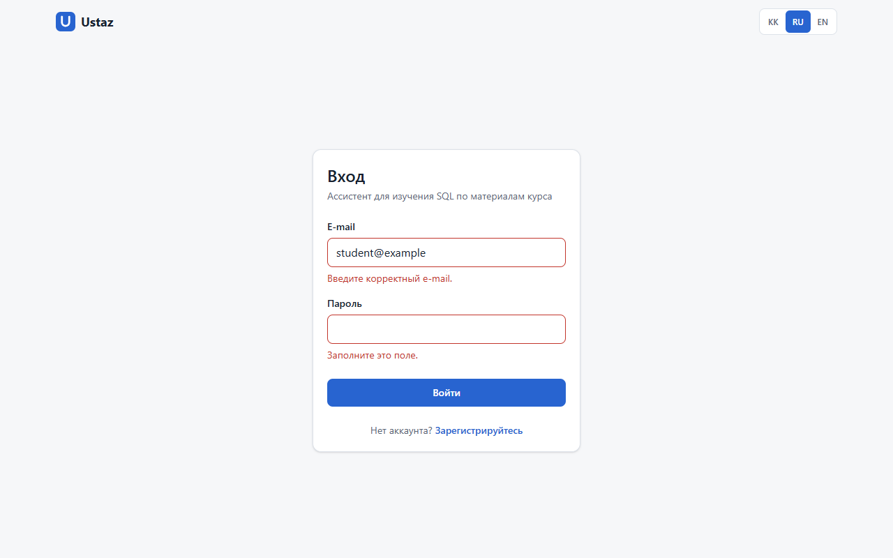 | 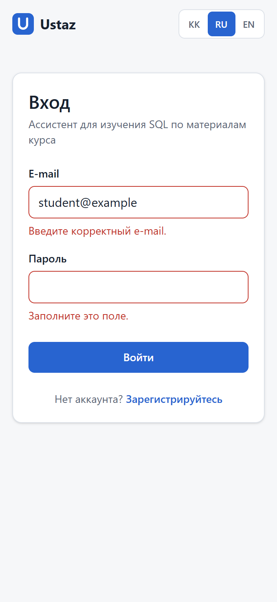 | 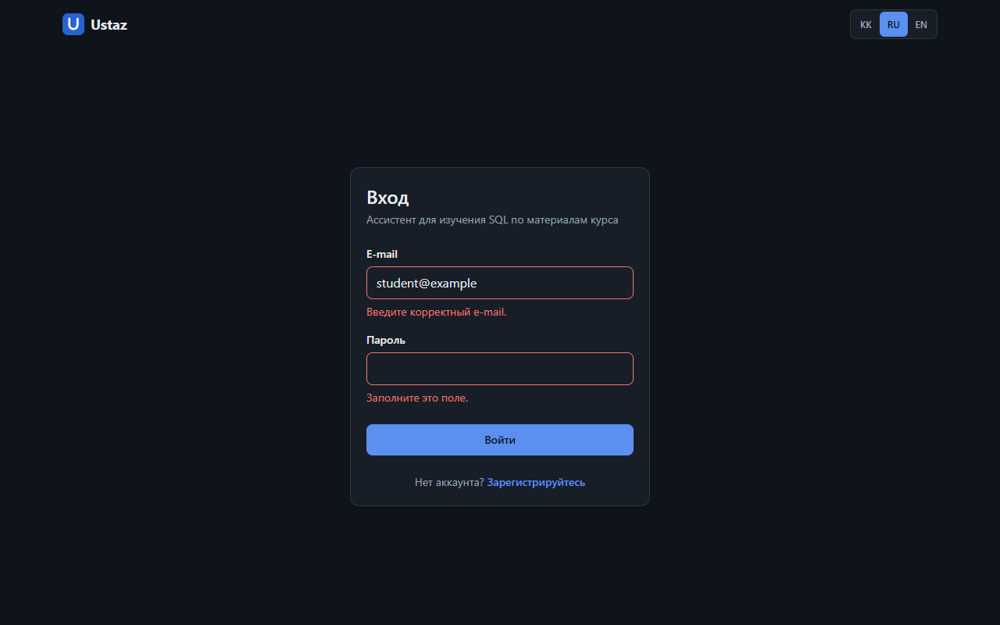 |

## 2. Чат

```
Ноутбук:
┌ Темы курса ───┐ ┌──────────────────────────────────────────────┐
│ 1. SELECT…    │ │                     [Объясни тему «…»]  (студент) │
│ 2. Сортировка │ │ ┌ Учитель (Сгенерировано ИИ) ──────────┐      │
│▶3. Агрегаты   │ │ │ текст, ```код```                      │      │
│ 4. JOIN       │ │ │ Источники: [Конспект: агрегаты…]      │      │
│ 5. Подзапросы │ │ └───────────────────────────────────────┘      │
└───────────────┘ │ ─────────────────────────────────────────────── │
                  │ [Объясни тему] [Подсказка] [Дай задание]        │
                  │ [ Сообщение…                       ] [Отправить] │
                  └──────────────────────────────────────────────────┘
Телефон: вместо колонки тем — выпадающий список «Тема» над чатом.
```

- Сообщения студента — справа, синие. Ответы ассистента — слева, белая карточка: имя агента, бейдж «Сгенерировано ИИ», текст с блоками кода, список источников.
- Быстрые действия работают, когда выбрана тема: «Объясни тему» (`action: explain`), «Подсказка» (`action: hint`), «Дай задание» (открывает экран задания).
- Enter — отправить, Shift+Enter — новая строка.
- Состояния: загрузка истории; пустой чат с подсказкой, что спросить; «Ассистент отвечает…» со спиннером; ошибка — красный блок над кнопками, текст сообщения возвращается в поле; лимит Free (429) — жёлтый блок со ссылкой «Перейти на Premium».
- Первый экран `/chat` — выбор курса и кнопка «Продолжить» для последней сессии.

| Ноутбук | Телефон | Тёмная тема |
|---|---|---|
| 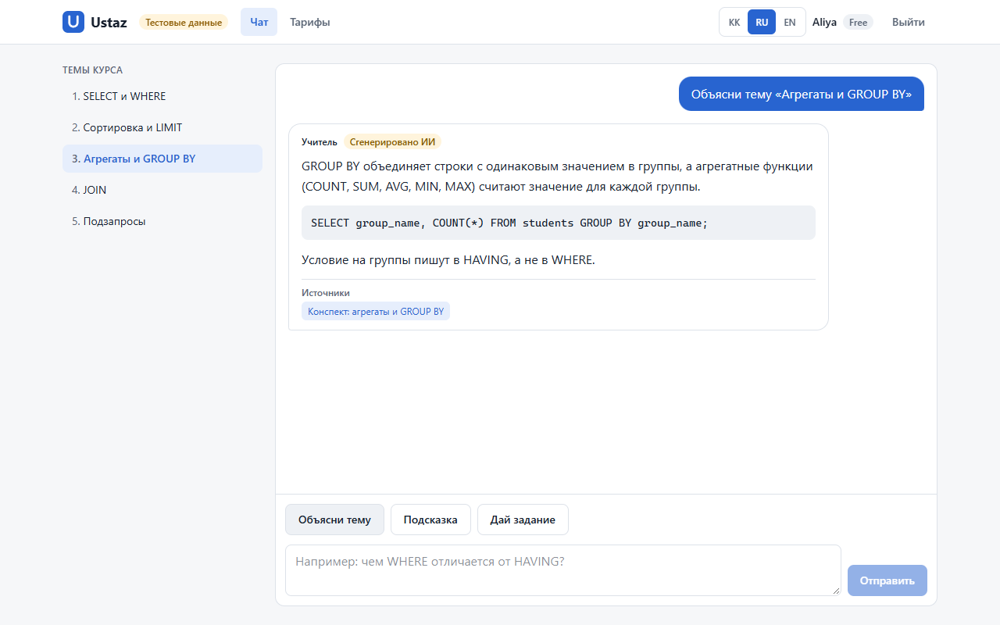 | 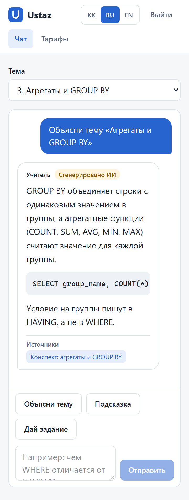 | 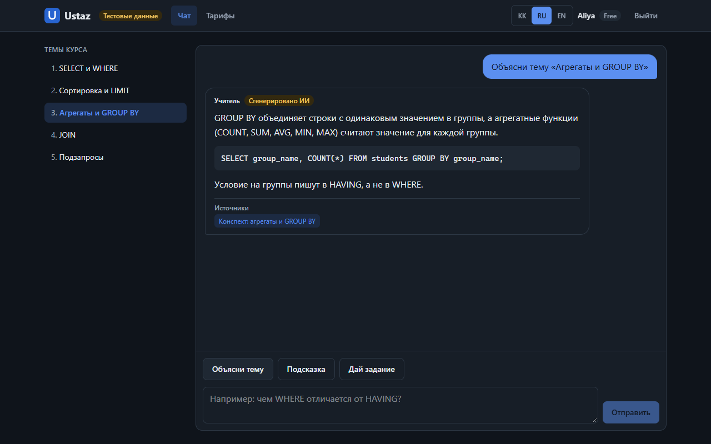 |

## 3. SQL-задание

```
Ноутбук:
← Вернуться в чат
┌ SQL-задание   Сложность: 1 ┐ ┌ Ваш SQL-запрос ─────────────────┐
│ Условие задания            │ │ [ SELECT …                     ] │
│ Таблицы учебной базы       │ │ [Проверить]  Ctrl + Enter        │
│ ┌students─┐ ┌grades──┐     │ └──────────────────────────────────┘
│ │id  INT  │ │…       │     │ ┌ (Верно! / Не совпадает / Ошибка)─┐
│ └─────────┘ └────────┘     │ │ Результат запроса (строк: N)     │
└────────────────────────────┘ │ таблица                          │
                               │ [Следующее задание]              │
                               └──────────────────────────────────┘
Телефон: условие, затем запрос, затем результат — одной колонкой.
```

- Схема таблиц — карточки «имя столбца — тип».
- Поле запроса — моноширинный шрифт, без автозамены и проверки орфографии.
- Результат по `feedback_code`: `correct` — зелёный, `wrong_result` — жёлтый, `sql_error` — красный плюс текст ошибки SQLite.
- Таблица результата — до 50 строк, прокрутка внутри, `NULL` серым курсивом.
- После верного ответа — «Следующее задание». После неверного — «Спросить подсказку в чате» (возвращает в чат и сразу просит подсказку) и «Другое задание».
- Эталонный ответ нигде не показывается.

| Ноутбук | Телефон | Тёмная тема |
|---|---|---|
| 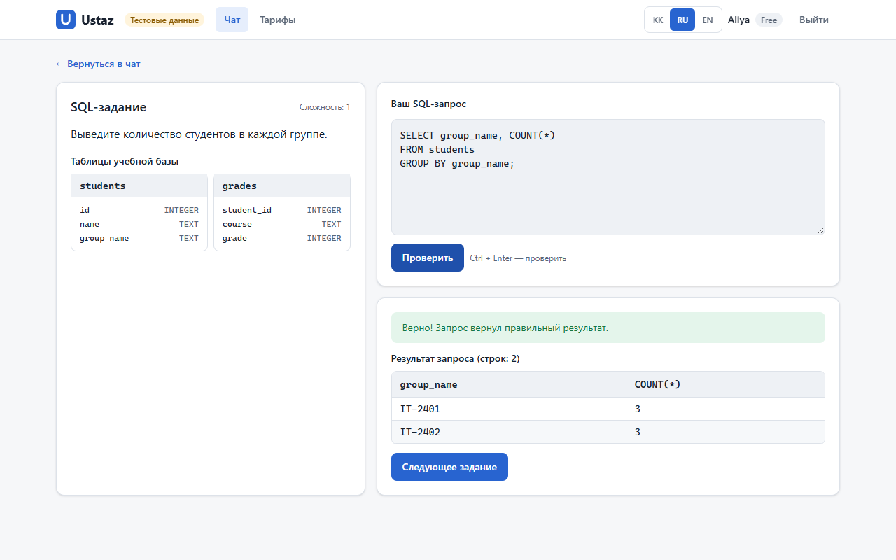 | 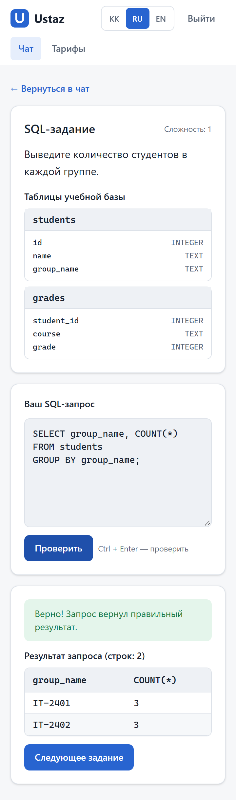 | 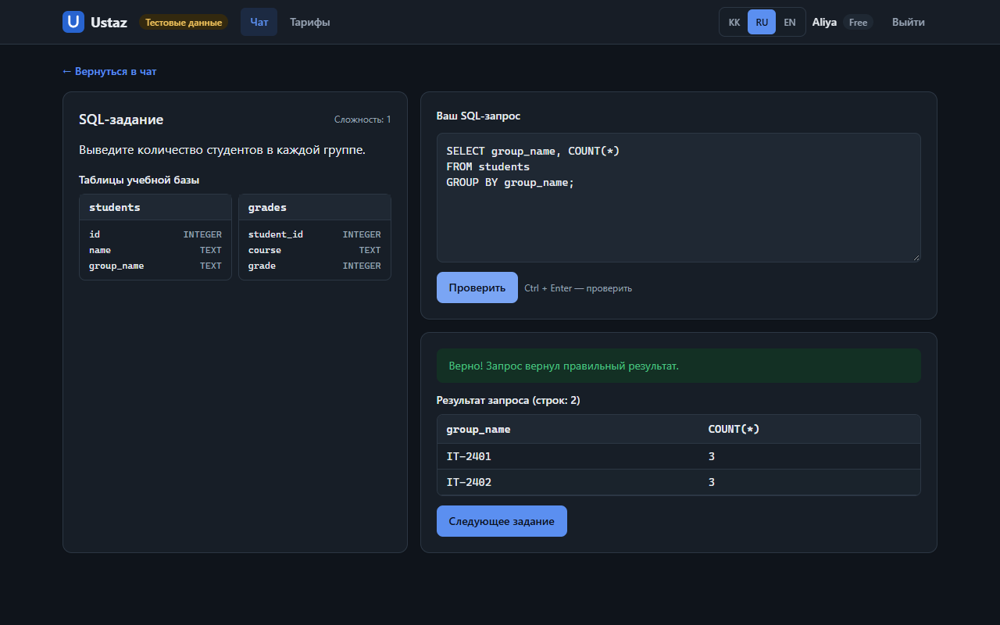 |

## 4. Тарифы

```
┌ Ваш тариф: (Free) ─────────────────────────────┐
│ Сообщений сегодня                        7 / 20 │
│ ███████░░░░░░░░░░░░░                            │
└─────────────────────────────────────────────────┘
┌ Free ──────────────────┐ ┌ Premium ───────────────┐
│ Бесплатно              │ │ 4,99 $ / месяц         │
│ До 20 сообщений в день │ │ Без лимита сообщений   │
│ ✓ …                    │ │ ✓ …                    │
│ [Ваш текущий тариф]    │ │ [ Перейти на Premium ] │
└────────────────────────┘ └────────────────────────┘
Телефон: карточки друг под другом.
```

- Текущий тариф выделен синей рамкой. Прогресс-бар становится красным, когда лимит исчерпан.
- Цена форматируется под язык интерфейса (`4,99 $` / `$4.99`).
- «Перейти на Premium»: с Paddle открывается окно оплаты Paddle Checkout поверх страницы; с тестовым провайдером план меняется сразу.
- После оплаты: «Оплата прошла, обновляем тариф…», затем «Готово! Тариф Premium подключён». Если план не обновился за 30 секунд — информационное сообщение обновить страницу позже.
- Для Premium показывается дата окончания оплаченного периода.

| Ноутбук | Телефон | Тёмная тема |
|---|---|---|
| 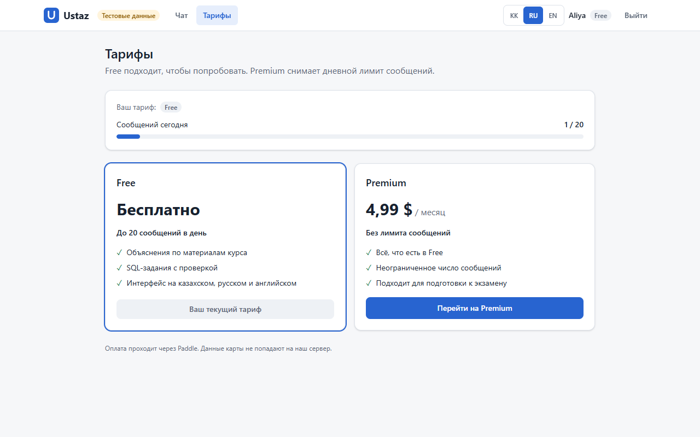 | 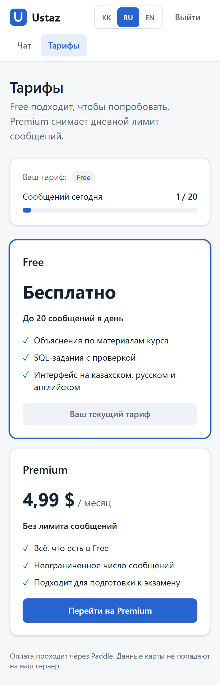 | 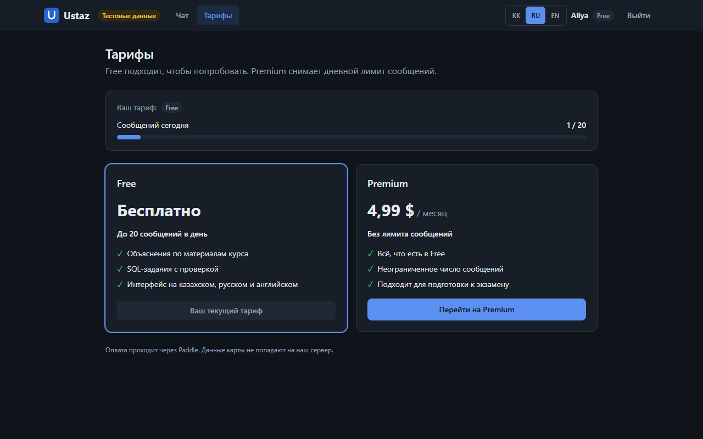 |
