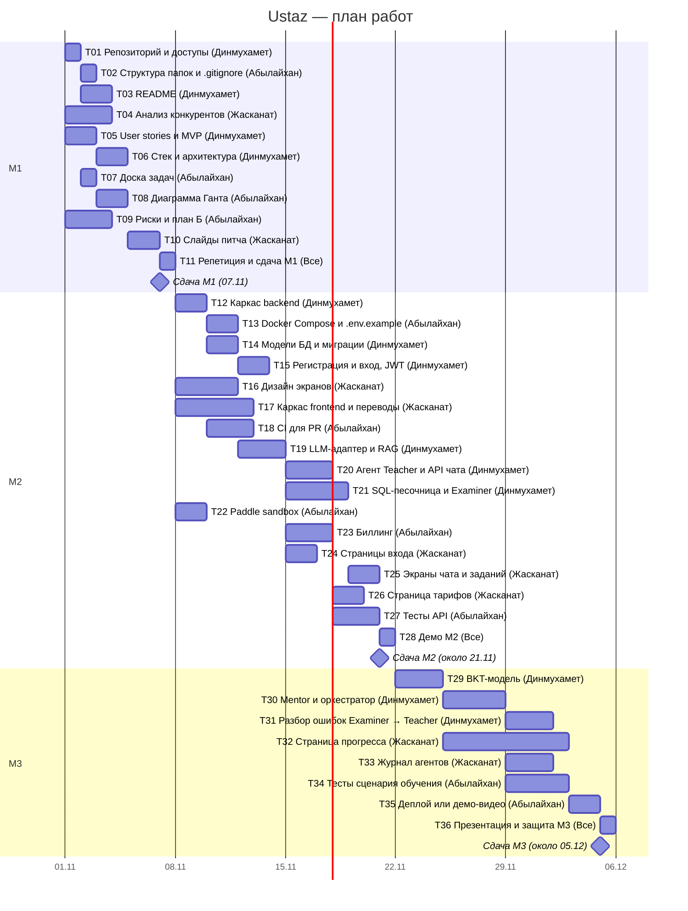

# Диаграмма Ганта

Недели: Н1 — 01–07.11.2026, Н2 — 08–14.11, Н3 — 15–21.11, Н4 — 22–28.11, Н5 — 29.11–05.12.

Сдача: M1 — 07.11, M2 — около 21.11, M3 — около 05.12.

Даты M2 и M3 предварительные: если преподаватель объявит другие, план сдвинется.

## Задачи и зависимости

| ID | Milestone | Задача | Ответственный | Неделя | Зависит от |
|---|---|---|---|---|---|
| T01 | M1 | Репозиторий, правила веток, доступы | Динмухамет | Н1 | — |
| T02 | M1 | Структура папок и .gitignore | Абылайхан | Н1 | T01 |
| T03 | M1 | README | Динмухамет | Н1 | T01 |
| T04 | M1 | Анализ конкурентов | Жасканат | Н1 | — |
| T05 | M1 | User stories и MVP | Динмухамет | Н1 | — |
| T06 | M1 | Обоснование стека и схема архитектуры | Динмухамет | Н1 | T05 |
| T07 | M1 | Доска задач в GitHub Projects | Абылайхан | Н1 | T01 |
| T08 | M1 | Диаграмма Ганта | Абылайхан | Н1 | T07 |
| T09 | M1 | Риски и план Б | Абылайхан | Н1 | — |
| T10 | M1 | Слайды питча | Жасканат | Н1 | T04, T06, T08 |
| T11 | M1 | Репетиция и сдача M1 | Все | Н1 | T10 |
| T12 | M2 | Каркас backend: FastAPI, конфиг, healthcheck | Динмухамет | Н2 | T02 |
| T13 | M2 | Docker Compose: backend, frontend, PostgreSQL + pgvector; .env.example | Абылайхан | Н2 | T12 |
| T14 | M2 | Модели БД и миграции | Динмухамет | Н2 | T12 |
| T15 | M2 | Регистрация и вход (JWT) | Динмухамет | Н2 | T14 |
| T16 | M2 | Дизайн экранов: вход, чат, задание, тарифы | Жасканат | Н2 | — |
| T17 | M2 | Каркас frontend и переводы kk/ru/en | Жасканат | Н2 | T02 |
| T18 | M2 | CI: линтер и тесты на каждый PR | Абылайхан | Н2 | T12 |
| T19 | M2 | LLM-адаптер и поиск по материалам (RAG) | Динмухамет | Н2 | T14 |
| T20 | M2 | Агент Teacher и API чата | Динмухамет | Н3 | T19 |
| T21 | M2 | SQL-песочница, агент Examiner, задания курса | Динмухамет | Н3 | T14 |
| T22 | M2 | Paddle sandbox: аккаунт, продукт Premium | Абылайхан | Н2 | — |
| T23 | M2 | Биллинг: checkout, webhook, лимит Free | Абылайхан | Н3 | T15, T22 |
| T24 | M2 | Страницы входа и регистрации | Жасканат | Н3 | T15, T17 |
| T25 | M2 | Экраны чата и SQL-задания | Жасканат | Н3 | T16, T20, T21 |
| T26 | M2 | Страница тарифов и оплата | Жасканат | Н3 | T23 |
| T27 | M2 | Тесты API: авторизация и биллинг | Абылайхан | Н3 | T15, T23 |
| T28 | M2 | Демо M2 | Все | Н3 | T20–T27 |
| T29 | M3 | BKT: обучение на открытых данных, метрики | Динмухамет | Н4 | — |
| T30 | M3 | Mentor и оркестратор: учебный цикл | Динмухамет | Н4 | T20, T21, T29 |
| T31 | M3 | Разбор ошибок: Examiner → Teacher | Динмухамет | Н5 | T30 |
| T32 | M3 | Страница прогресса (карта освоения) | Жасканат | Н4–Н5 | T29 |
| T33 | M3 | Журнал агентов для админа | Жасканат | Н5 | T30 |
| T34 | M3 | Тесты сценария обучения, исправление багов | Абылайхан | Н5 | T30 |
| T35 | M3 | Деплой или демо-видео | Абылайхан | Н5 | T34 |
| T36 | M3 | Презентация и защита M3 | Все | Н5 | T31–T35 |
